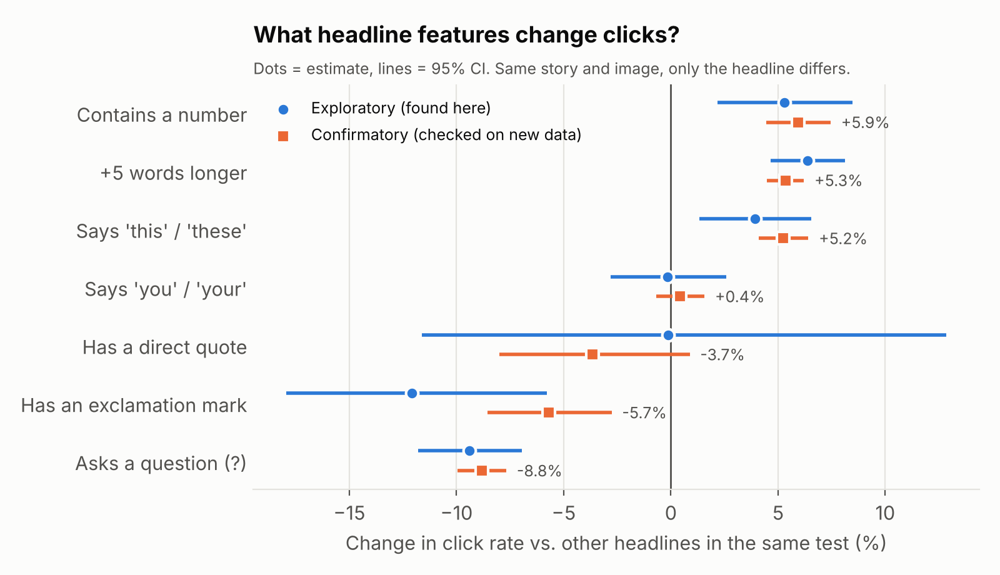
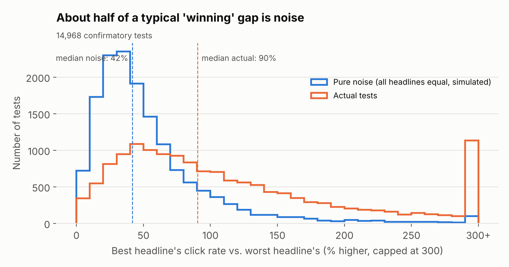

# What makes a news headline get clicked?

An analysis of 18,000+ real headline A/B tests from Upworthy (2013 to 2015), built with DuckDB, SQL, and Python.

Upworthy tested almost every story by showing different headlines to random readers and counting clicks. This project asks two questions:

1. **How many of those tests found a real winner, and how much of the "winning" gap was just noise?**
2. **Which headline features (questions, numbers, length, and so on) actually change click rate?**

To keep myself honest, I found patterns on one part of the data (exploratory set), wrote my predictions down, and then checked them on a separate, larger part (confirmatory set) that I hadn't looked at.

## Key findings

**1. All 5 feature effects found in the exploratory data replicated on new data.**



Comparing headlines inside the same test, with the same story and image:

| Headline feature | Exploratory (2,056 comparisons) | Confirmatory (9,917 comparisons) | Replicated? |
|---|---|---|---|
| Asks a question | -9.4% CTR | **-8.8%** | Yes |
| Contains a number | +5.3% | **+5.9%** | Yes |
| Says "this" / "these" | +3.9% | **+5.2%** | Yes |
| 5 words longer | +6.4% | **+5.3%** | Yes |
| Exclamation mark | -12.1% | **-5.7%** | Yes, but half the size |
| Says "you" / "your" | -0.2% (no effect) | +0.4% (no effect) | Stayed null |
| Direct quote | -0.1% (no effect) | -3.7% (no effect) | Stayed null |

The exclamation mark effect shrank by half on new data. It was rare (2% of headlines), so its first estimate was noisy. This is why checking on held-out data matters.

**2. Noise explains about half of a typical test's "winning" gap.**



In a typical test, the best headline beat the worst by about 90%. But when I simulated the same tests with every headline set to the same true click rate, the best still beat the worst by about 42%, just from chance. Picking the top number from several noisy ones always looks like a win.

**3. Most tests did not have a real winner.**

| | Exploratory | Confirmatory |
|---|---|---|
| Tests analyzed | 3,176 | 14,968 |
| Significant difference (chi-square, p < 0.05) | 49% | 49% |
| Still significant after false discovery rate correction | 39% | 41% |
| Tests where editors marked a winner | 605 | 2,858 |
| ...and that winner had the highest CTR | 74% | 74% |
| ...and the test had a real difference (FDR-corrected) | 32% | 35% |

When editors picked a winning headline, about two out of three times the test did not show a statistically real difference. The archive's own "significance" column is not a real significance test (the archive team says the method was lost), so editors were likely deciding with a misleading number.

## Method

**Data.** [The Upworthy Research Archive](https://upworthy.natematias.com/) (Matias et al., 2021, *Scientific Data*). Exploratory set: 22,666 packages from 4,873 tests. Confirmatory set: 105,551 packages from 22,743 tests.

**Cleaning (`sql/01_clean.sql`, DuckDB).**
- Removed tests from June 25, 2013 to January 10, 2014. The archive team found broken randomization in this window and advises against using it.
- Readers only saw the headline and image. Packages in the same test with the same headline and image (differing only in text readers never saw) were merged into one arm.
- For the feature analysis, kept only comparisons where the image was the same and the headline differed, so the headline is the only thing that changed.

**Test-level results (`src/ab_results.py`).**
- Chi-square test per test (do all arms share one click rate?), then Benjamini-Hochberg correction across thousands of tests.
- Noise baseline: for each test, simulated clicks with every arm at the pooled click rate, then measured best-vs-worst gap the same way as for the real data.

**Feature model (`src/feature_model.py`).**
- Poisson regression of clicks with log(impressions) as an offset and a fixed effect for each (test, image) group. This compares headlines only against other headlines for the same story and image.
- The group effects are solved in closed form, so the model fits 43,000 arms in about 1 second. `tests/check_model.py` confirms it matches a standard logistic regression with one dummy per group (all estimates within 0.2 percentage points).
- Standard errors clustered by test. Holm correction across the 7 features.
- All features are in one model, so each effect is measured holding the others fixed.

**Confirmation.** Predictions were written to `results/predictions_before_confirmatory.md` before the confirmatory data was analyzed. A prediction counts as replicated if the confirmatory estimate has the same sign and Holm-corrected p < 0.05.

## Limitations

- **Features were not randomly assigned.** Within a test, readers were randomly shown headlines, so the click differences between those headlines are real. But editors wrote the headlines, so a headline with a question might also differ in other ways (tone, topic framing). The feature effects are strong patterns, not proof that adding a "?" causes fewer clicks.
- **Clicks are not reading.** CTR measures whether people clicked, not whether they read or shared the story.
- **One site, one era.** Upworthy's 2013 to 2015 audience and Facebook-driven traffic may not match news sites today.
- Features are simple text rules (for example, "contains a digit"). They were spot-checked by hand but will miss some cases.

## How to run

```bash
pip install -r requirements.txt
# Download the two CSVs from https://osf.io/jd64p/ (upworthy-archive-datasets/)
# and save them as data/exploratory.csv and data/confirmatory.csv
bash run_all.sh
```

## Project structure

```
sql/01_clean.sql          DuckDB cleaning: flag bad window, merge arms, build headline-only comparisons
src/load.py               Loads a CSV into DuckDB and runs the cleaning SQL
src/ab_results.py         Test-level significance, FDR correction, noise simulation
src/features.py           Headline text features
src/feature_model.py      Fixed-effects Poisson model with clustered standard errors
src/charts.py             Figures
tests/check_model.py      Checks the fast model against a standard logistic regression
results/                  Output tables and the locked predictions file
figures/                  Charts used above
```

## Data credit

Matias, J. N., Munger, K., Aubin Le Quere, M., & Ebersole, C. (2021). The Upworthy Research Archive, a time series of 32,487 experiments in U.S. media. *Scientific Data*, 8, 195. Data licensed CC BY 4.0.
